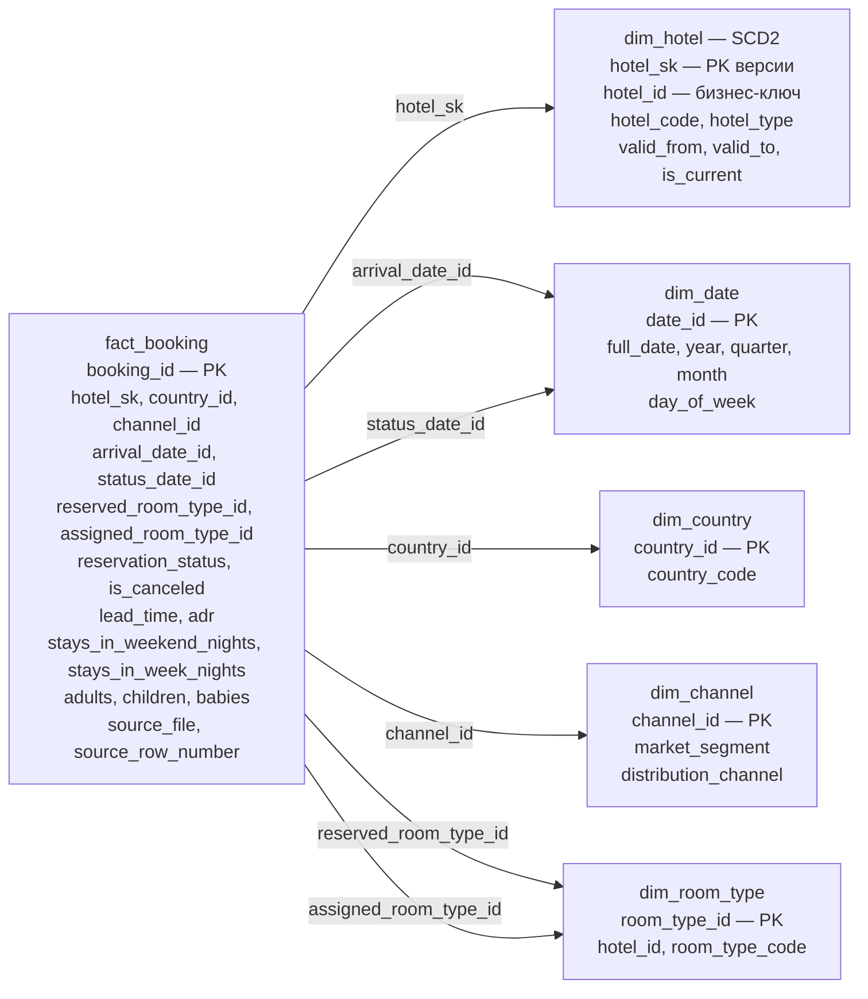

# Набросок star-схемы

Домен D5 — бронирования. Это проектируемая схема; загрузка H1/H2 и создание новых таблиц ещё не выполнены.

**Одна строка fact_booking = одно бронирование.** Загружаем все статусы, главная метрика считает только reservation_status = 'Check-Out'.

Всего шесть таблиц: один факт и пять измерений. Стрелки показывают внешние ключи из факта; каждой строке справочника может соответствовать много бронирований.

## Источники и ключи

- data/H1.csv — Resort Hotel; data/H2.csv — City Hotel. Планируемое размещение сырья — data/raw/hotel/; содержимое файлов сохраняем.
- booking_id — технический ключ из кода H1/H2 и номера записи данных без заголовка. Совпадающие по содержимому строки сохраняем. Повторная загрузка того же сырья не должна создавать дубли.
- hotel_id — постоянный идентификатор отеля; hotel_sk — ключ версии dim_hotel. Версия выбирается на дату заезда: `valid_from <= arrival_date AND (arrival_date < valid_to OR valid_to IS NULL)`. Интервалы одного отеля не пересекаются. В факте хранится найденный hotel_sk, чтобы соединение не размножало бронирования по версиям.
- arrival_date_id выводим из ArrivalDateYear, ArrivalDateMonth, ArrivalDateDayOfMonth; status_date_id — из ReservationStatusDate. Один календарь обслуживает обе роли. Главную метрику группируем по дате заезда.
- channel_id соответствует уникальному сочетанию MarketSegment + DistributionChannel; оба признака доступны для группировки.
- room_type_id соответствует паре «отель + код типа номера». Один справочник обслуживает забронированный и назначенный тип. При загрузке обе ссылки должны соответствовать постоянному hotel_id выбранной версии отеля. hotel_id в этом измерении задаёт контекст кода; факт соединяем с каждым справочником напрямую.
- В строках обрезаем пробелы, текстовый NULL распознаём как пропуск. Для неизвестных значений измерений предусматриваем явные строки справочников.
- Статус сохраняем в факте как reservation_status из ReservationStatus; отдельное измерение статуса не создаём.

